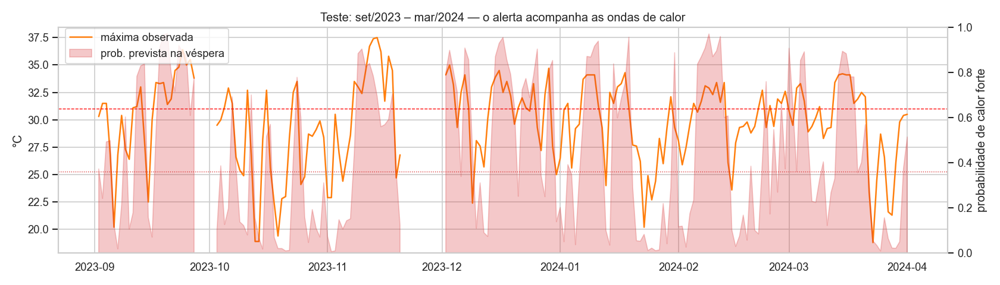

# ☀️ SombraSP — previsão de dias de calor forte em São Paulo

**Machine Learning com dados reais do INMET para avisar, na véspera, quem passa o dia no sol.**


-2E7D32)


Toda noite, o modelo responde uma pergunta simples: **amanhã a temperatura máxima no Centro de São Paulo vai passar de 31 °C?** Se a resposta for sim, a SombraSP manda um alerta para idosos e trabalhadores de rua (ambulantes, entregadores, garis) se prepararem: levar água, evitar o sol do meio-dia e saber onde há sombra e hidratação por perto.


<sub>Verão 2023/24, período que o modelo nunca viu no treino: a área vermelha é a probabilidade de calor forte calculada na véspera; a linha laranja, a máxima que de fato aconteceu.</sub>

## Resultados

Avaliação em **jan/2023 a out/2026**, anos que o modelo nunca viu e que foram mais quentes que os de treino:

| | Regra "amanhã igual a hoje" | **SombraSP (Random Forest)** |
|---|---|---|
| Dias de calor forte avisados na véspera | 66 % | **81 %** |
| 1º dia de onda de calor avisado | 0 de 97 | **45 de 97** |
| ROC-AUC | — | **0,91** |
| Alertas que se confirmaram | 66 % | 60 % |

A regra simples já é forte, porque a temperatura tem inércia, mas ela nunca antecipa o **primeiro dia** de uma onda de calor, justamente o que pega as pessoas desprevenidas. O modelo avisa quase metade desses dias. O custo são mais alarmes falsos, uma troca aceitável num alerta de saúde: um aviso a mais custa uma garrafa de água levada à toa; um aviso a menos pode custar um dia inteiro no sol sem preparo.

## Como funciona

```
INMET A701 (dados horários, 2015–2026)
   │  limpeza: falhas de sensor, limites físicos, dias incompletos
   ▼
18 variáveis por dia: temperatura, umidade, pressão, chuva, radiação, vento,
histórico dos últimos dias e época do ano
   │
   ▼
Random Forest ── 24 combinações de hiperparâmetros, validação cruzada temporal
   │
   ▼
P(máxima de amanhã ≥ 31 °C)  ──  ≥ 0,36?  ──►  alerta na véspera
```

- **Dados reais e públicos:** estação automática A701 (São Paulo – Mirante de Santana), [portal de dados históricos do INMET](https://portal.inmet.gov.br/dadoshistoricos), de 01/01/2015 a 31/10/2026, com 103.728 registros horários.
- **Divisão no tempo:** treino de 2015 a 2022 e teste de 2023 a 2026. Treina-se com o passado e prevê-se o futuro, sem embaralhar os dias.
- **Escolha do modelo:** 3 hiperparâmetros (`n_estimators`, `max_depth`, `min_samples_leaf`), 24 combinações, `TimeSeriesSplit` de 5 dobras **só no treino**.
- **Por que 31 °C:** é o percentil 84 das máximas diárias, cerca de 1,5 °C acima da média de janeiro, o mês mais quente.

Toda a análise, com gráficos e a discussão de overfitting, está no **[notebook executado](ml/sombrasp_risco_calor.ipynb)** e no **[relatório](RELATORIO_ML.md)**.

## Rodando o projeto

Requer Python 3.11 ou 3.12. Os dados já vêm no repositório.

```bash
git clone https://github.com/GabrielBarros0602/SombraSP-IA-ML.git
cd SombraSP-IA-ML/ml
python -m venv .venv
.venv\Scripts\activate            # Linux/macOS: source .venv/bin/activate
pip install -r requirements.txt
jupyter nbconvert --to notebook --execute --inplace sombrasp_risco_calor.ipynb   # ~1 min
```

Para explorar célula por célula, use `jupyter notebook sombrasp_risco_calor.ipynb`. Para baixar os dados de novo direto do INMET, rode `python dados/baixar_dados_inmet.py`, um download de ~1,2 GB em ZIPs anuais, dos quais o script guarda só a estação A701.

## Estrutura

```
.
├── README.md                 ← você está aqui
├── RELATORIO_ML.md           ← relatório completo, do problema à conclusão
├── prompts.md                ← registro do uso de IA no projeto
├── docs/ROTEIRO_VIDEO.md     ← roteiro do vídeo de apresentação
└── ml/
    ├── sombrasp_risco_calor.ipynb   ← notebook executado, com saídas
    ├── requirements.txt
    ├── figuras/                     ← gráficos gerados pelo notebook
    └── dados/
        ├── README.md                ← fonte, link, período e dicionário de colunas
        ├── baixar_dados_inmet.py    ← refaz o download do INMET
        └── brutos/                  ← CSVs originais da A701, 2015–2026
```

## Limites

- Uma única estação, na zona norte, mais fresca que o asfalto da Sé e da República. Na SombraSP, o modelo é combinado com estações ESP32 nas ruas do Centro.
- O modelo só usa o histórico da própria estação. Incluir a previsão numérica do tempo e outras estações da Grande SP deve melhorar o aviso do primeiro dia das ondas.

## Sobre a SombraSP

Este repositório é a parte de **Inteligência Artificial & Machine Learning** da SombraSP, CitizenTech criada para a Global Solution FIAP 2026.2 (Engenharia de Software, 3º ano).

| Campo | Valor |
|---|---|
| **Nome** | SombraSP |
| **Cidade e bairro** | São Paulo — Centro (Sé / República) |
| **Cidadão beneficiado** | Idosos e trabalhadores de rua (ambulantes, entregadores, garis) expostos ao sol |
| **Problema, em uma frase** | Nos dias de calor extremo, quem passa o dia na rua não recebe aviso a tempo nem sabe onde encontrar sombra e água por perto. |
| **Como funciona** | Sensores (ESP32) e dados meteorológicos públicos (INMET) estimam o risco de calor; quando o risco sobe, a plataforma emite alertas e mostra pontos de sombra e hidratação próximos. |
| **O que cada parte faz** | **IA&ML:** prevê na véspera, com dados reais do INMET (estação A701), se o dia seguinte será de calor forte (máxima ≥ 31 °C), disparando o alerta antecipado. **Physical Computing:** estação ESP32 (Wokwi) mede temperatura/umidade, calcula índice de calor e aciona alerta local (LED/buzzer/display). **Operating Systems:** infraestrutura Linux que provisiona e hospeda a web app SombraSP, com monitoramento e logs. **Testing:** features, critérios de aceite e casos de teste no Azure Boards. |
| **Indicador de impacto** | Nº de alertas emitidos em dias de risco e nº de consultas a pontos de sombra/hidratação. |
| **ODS conectados** | ODS 3 (Saúde e bem-estar), ODS 11 (Cidades sustentáveis), ODS 13 (Ação contra a mudança do clima), ODS 10 (Redução das desigualdades) |

🎬 **Vídeo de apresentação (5 min):** *em breve*

## Autores

| Nome | RM |
|---|---|
| Gabriel Barros Cisoto (líder) | RM556309 |
| Felipe Marques de Oliveira | RM556319 |

## Licença

Código sob licença [MIT](LICENSE). Os dados meteorológicos são públicos e pertencem ao **INMET — Instituto Nacional de Meteorologia**; ao reutilizá-los, cite a fonte.
