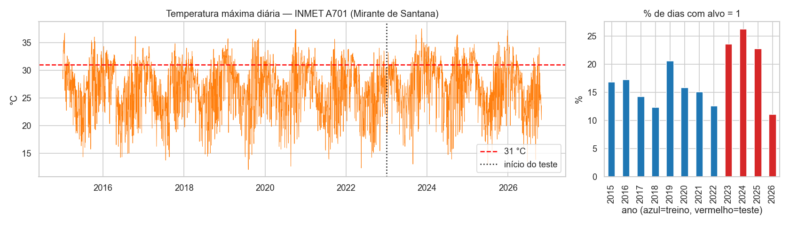
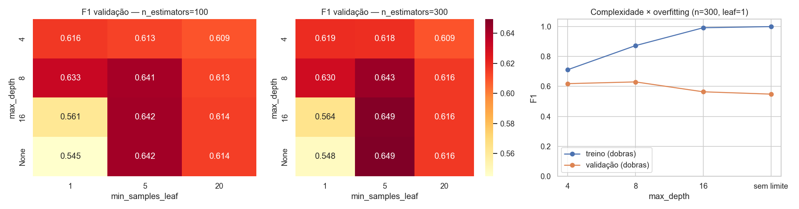
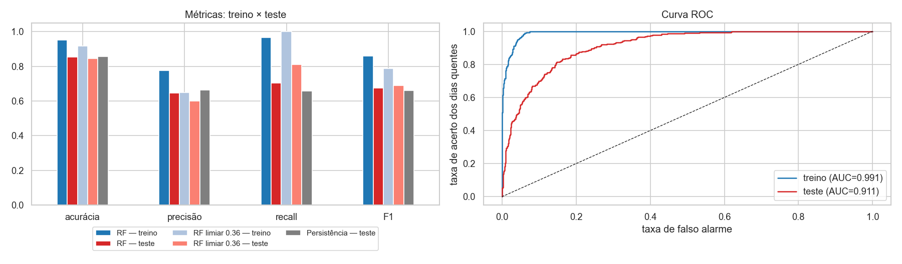
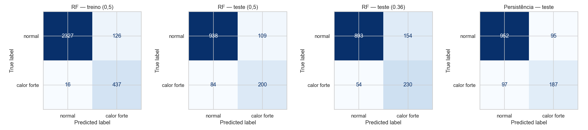
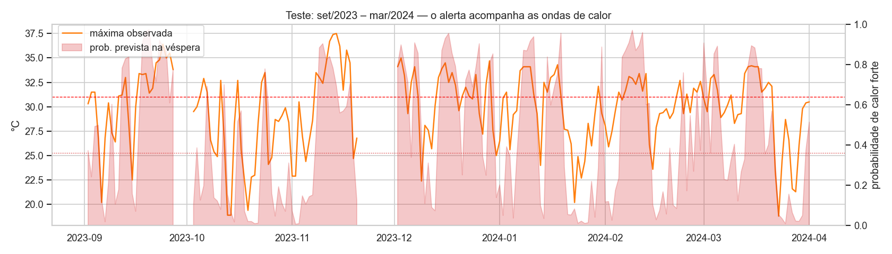

# Relatório de IA & ML — SombraSP

**Global Solution FIAP 2026.2 · Engenharia de Software, 3º ano**
Gabriel Barros Cisoto (RM556309) · Felipe Marques de Oliveira (RM556319)
Notebook: [`ml/sombrasp_risco_calor.ipynb`](ml/sombrasp_risco_calor.ipynb)

## 1. Problema e pergunta de ML

A SombraSP é uma CitizenTech de alertas de calor extremo para **idosos e trabalhadores de rua** (ambulantes, entregadores, garis) do Centro de São Paulo (Sé / República). O problema: nos dias de calor forte, quem passa o dia na rua não é avisado a tempo de se preparar (água, roupa, horários, saber onde há sombra).

Transformamos isso em uma pergunta de Machine Learning que dá para responder com dados públicos:

> **Com os dados medidos hoje na estação do INMET, amanhã a temperatura máxima vai chegar a 31 °C ou mais?**

É uma **classificação binária** (1 = calor forte amanhã). A resposta é o gatilho do alerta da véspera na plataforma.

**Por que 31 °C:** no período de treino (2015–2022), 31 °C é o percentil 84 das máximas diárias e fica ~1,5 °C acima da máxima média de janeiro (29,5 °C), o mês mais quente. É um calor que pesa para quem fica horas no sol e acontece em cerca de 1 a cada 6 dias, o que dá exemplos suficientes para o modelo e torna o alerta útil fora dos dias de recorde. Testamos também o índice de calor ≥ 32 °C, mas ele só ocorre em ~4 % dos dias (o calor de SP costuma ser seco), poucos exemplos para treinar.

## 2. Dados reais

| | |
|---|---|
| Fonte | INMET — Banco de Dados Meteorológicos, Dados Históricos |
| Link | https://portal.inmet.gov.br/dadoshistoricos |
| Estação | A701 — São Paulo, Mirante de Santana (estação automática de referência da cidade, ~5 km da Sé) |
| Período | 01/01/2015 a 31/10/2026, dados **horários** (103.728 registros) |
| Variáveis | temperatura, ponto de orvalho, umidade, pressão, chuva, radiação, vento e rajada |

Os CSVs originais estão em `ml/dados/brutos/` e podem ser baixados de novo com `ml/dados/baixar_dados_inmet.py`. Detalhes das colunas e do formato em `ml/dados/README.md`. **Nenhum dado é simulado.**

## 3. Modelo escolhido: Random Forest

| Opção | Por que sim / por que não |
|---|---|
| **Random Forest** ✅ | dados tabulares e pequenos (~4 mil dias); capta relações não lineares (ex.: seco + pressão caindo); média de muitas árvores reduz overfitting; poucos hiperparâmetros relevantes; mostra a importância das variáveis, o que ajuda a explicar o alerta; `class_weight="balanced"` trata o desbalanceamento (17 % de positivos). |
| XGBoost | costuma empatar ou ganhar por pouco nesse tamanho, mas tem mais hiperparâmetros sensíveis e é mais fácil de sobreajustar. Preferimos a estabilidade e a clareza da floresta para um alerta público. |
| MLP / LSTM | precisam de muito mais dados e de normalização; com ~3 mil dias de treino tendem a decorar a série. |
| KMeans + PCA | não supervisionado; aqui temos um alvo definido. |

## 4. Preparação e divisão treino/teste

1. **Leitura e padronização:** os CSVs mudam de formato em 2019 (data `2015-01-01`/`2019/01/01`, hora `00:00`/`0000 UTC`); lemos pelas posições das 19 colunas. `-9999` e vazios viram `NaN`. Horário convertido de UTC para Brasília, para o "dia" ser o dia que o cidadão vive.
2. **Limpeza:** limites físicos (temperatura −5 a 45 °C, umidade 1–100 %, pressão 850–960 hPa etc.; nenhuma leitura precisou ser removida); descarte de **30 dias com menos de 20 h válidas**, para a máxima não ser subestimada.
3. **Agregação diária e variáveis (18):** máxima, mínima, média e amplitude da temperatura; umidade mínima e média; ponto de orvalho; pressão média e variação em relação a ontem; chuva; radiação; vento médio e rajada; máxima de ontem, de anteontem e média de 3 dias; estação do ano (seno/cosseno do dia do ano).
4. **Alvo:** máxima do **dia seguinte** ≥ 31 °C. Nenhuma variável usa dados de amanhã (sem vazamento). Base final: **4.237 dias**.
5. **Divisão cronológica** (série temporal não pode ser embaralhada):

| | Período | Dias | % calor forte |
|---|---|---|---|
| Treino | 03/01/2015 – 31/12/2022 | 2.906 | 15,6 % |
| Teste | 01/01/2023 – 30/10/2026 | 1.331 | 21,3 % |

O teste é mais quente que o treino (2023–2024 tiveram recordes de calor em SP), o que torna a avaliação mais difícil e mais realista.

## 5. Treino com diferentes hiperparâmetros

Busca em grade com **3 hiperparâmetros e 24 combinações**, validação cruzada `TimeSeriesSplit` de 5 dobras **só no treino** (cada dobra treina com o passado e valida no período seguinte), 120 treinos no total. Métrica de escolha: **F1 da classe calor forte** (acurácia engana: "nunca avisar" acerta 83 %).

| Hiperparâmetro | Valores testados |
|---|---|
| `n_estimators` | 100, 300 |
| `max_depth` | 4, 8, 16, sem limite |
| `min_samples_leaf` | 1, 5, 20 |

**Melhor:** `n_estimators=300`, `max_depth=None`, `min_samples_leaf=5` → F1 de validação 0,649 (ROC-AUC 0,918). O que mais pesou foi `min_samples_leaf`: com 1 dia por folha e árvores profundas o modelo decora o treino (F1 de treino 1,00, validação 0,55); com 20 ele simplifica demais (0,61); 5 é o equilíbrio. O número de árvores quase não muda o resultado.

**Limiar do alerta.** O modelo dá uma probabilidade. Como deixar de avisar é pior que um alarme falso, adotamos a política "avisar em pelo menos 8 de cada 10 dias quentes" e escolhemos o limiar que cumpre isso nas probabilidades **fora da amostra das dobras de treino**: **0,36**. O teste não foi usado nessa escolha.

## 6. Resultados: treino × teste

| Métrica | RF treino (0,5) | RF validação cruzada | RF teste (0,5) | RF treino (0,36) | **RF teste (0,36)** | Persistência teste |
|---|---|---|---|---|---|---|
| Acurácia | 0,951 | — | 0,855 | 0,916 | **0,844** | 0,856 |
| Precisão | 0,776 | 0,595 | 0,647 | 0,650 | **0,599** | 0,663 |
| Recall | 0,965 | 0,715 | 0,704 | 1,000 | **0,810** | 0,658 |
| F1 | 0,860 | 0,649 | 0,675 | 0,788 | **0,689** | 0,661 |
| ROC-AUC | 0,991 | 0,918 | 0,911 | 0,991 | **0,911** | — |

*Persistência* = regra sem modelo, "amanhã vai ser como hoje" (avisa se hoje passou de 31 °C).

**Overfitting.** Existe e está controlado. O treino é bem melhor que o teste (F1 0,86 contra 0,68; AUC 0,99 contra 0,91), comportamento típico de Random Forest. O ponto central é que a **validação cruzada (0,649) previu bem o teste (0,675)**: o desempenho estimado só com dados de 2015–2022 se confirmou em quase 4 anos nunca vistos e mais quentes. Os hiperparâmetros foram escolhidos pela validação, e não pelo treino, justamente para evitar a combinação que decora os dados (folhas de 1 dia).

**Onde o modelo ganha da regra simples.** A temperatura tem muita inércia, então "amanhã igual a hoje" já é uma referência forte e, no limiar 0,5, o modelo fica só um pouco acima (F1 0,675 contra 0,661). O ganho aparece nos dias que mais importam:

| No teste (2023–2026) | Persistência | RF 0,5 | RF 0,36 |
|---|---|---|---|
| 1º dia de onda de calor avisado (de 97) | **0** | 26 | **45** |
| Dias de calor forte avisados (de 284) | 187 (66 %) | 200 (70 %) | **230 (81 %)** |
| Alarmes falsos (de 1.047 dias normais) | 95 | 109 | 154 |

As variáveis mais importantes foram a máxima de hoje, a temperatura média, a média de 3 dias, a amplitude térmica e a época do ano, o que faz sentido físico. Testamos também variáveis da noite (temperatura, umidade e pressão às 21h) e vento em componentes norte/leste num teste exploratório fora do notebook: o F1 no teste ficou igual (0,673 contra 0,675), então elas não entraram no modelo.

## 7. Conclusão para o cidadão

Com os dados públicos do INMET de hoje, a SombraSP consegue avisar **na véspera cerca de 8 em cada 10 dias de calor forte** no Centro de São Paulo, incluindo quase metade dos **primeiros dias das ondas de calor**, que são os que pegam as pessoas desprevenidas e que a simples observação do "hoje está quente" nunca antecipa.

O preço é que cerca de **4 em cada 10 alertas são "falsos"**: o dia fica quente, mas abaixo de 31 °C. Para um alerta de saúde essa troca vale a pena: um aviso a mais custa uma garrafa de água levada à toa; um aviso a menos pode ser um idoso ou um ambulante passando o dia no sol sem se preparar. Na prática, a mensagem chega à noite: *"Amanhã deve passar de 31 °C. Leve água, evite o sol das 11h às 16h e veja os pontos de sombra e hidratação perto de você."*

**Limites:** uma única estação, na zona norte, mais fresca que o asfalto da Sé/República. Por isso a SombraSP combina o modelo com as estações ESP32 de rua (Physical Computing), que medem o calor no próprio Centro. **Próximos passos:** usar também a previsão numérica do tempo e outras estações do INMET da Grande SP, o que deve melhorar principalmente o aviso do primeiro dia das ondas.
